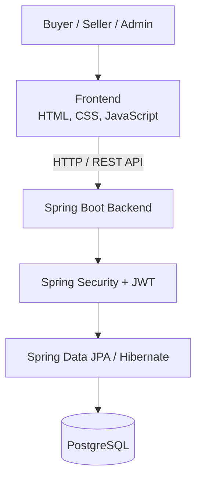

# MARTplus — Multi-Vendor E-Commerce Platform

MARTplus is a full-stack e-commerce web application built as a B.Tech Computer Science and Engineering project. It brings buyer shopping workflows and seller product-management workflows together, with role-based access for buyers, sellers, and administrators.

> **Project status:** Academic project / ongoing development. Features and integrations should be considered implemented only where supported by the current codebase and deployment.

## Live Demo

- **Frontend:** https://martplus-frontend.onrender.com
- **Backend health check:** https://martplus-backend.onrender.com/api/health

The backend may take a little time to respond after a period of inactivity on a free hosting plan.

## Highlights

### Buyer experience
- Register and sign in with a buyer account.
- Browse products and navigate product categories.
- Add products to the shopping cart.
- Save products to a wishlist.
- Manage delivery addresses and view order-related pages.
- Access buyer-specific features based on the user's account role.

### Seller experience
- Register and sign in with a seller account.
- Access the seller area and product-management pages.
- Create and manage product listings, including pricing and available stock.
- Access seller-related order and inventory workflows where available in the application.

### Administration and security
- Separate account roles: `BUYER`, `SELLER`, and `ADMIN`.
- Role-aware login and access control.
- Spring Security for request security.
- JWT-based authentication.
- BCrypt password hashing.
- PostgreSQL for persistent application data.

> Payment gateway processing, email/SMS delivery, analytics, and other third-party integrations may require additional configuration. Do not assume a live payment gateway or third-party notification service is enabled unless it has been configured and tested.

## Technology Stack

| Area | Technologies | Purpose |
| --- | --- | --- |
| Frontend | HTML5, CSS3, JavaScript | Website interface and client-side interactions |
| Backend | Java 21, Spring Boot 3.5.x | REST API and business logic |
| Security | Spring Security, JWT, BCrypt | Authentication, role-based access, password hashing |
| Persistence | Spring Data JPA, Hibernate | Object-relational mapping and database access |
| Database | PostgreSQL | Persistent application data |
| Build | Maven Wrapper | Build and run the Spring Boot application |
| Version control | Git, GitHub | Source-code management |
| Hosting | Render | Frontend, backend, and PostgreSQL hosting |

## High-Level Architecture



## Repository Structure

```text
MARTplus/
├── backend/
│   └── ShopSphere/
│       ├── mvnw
│       ├── pom.xml
│       └── src/
│           └── main/
│               ├── java/com/ShopSphere/
│               └── resources/application.properties
└── frontend/
    ├── login.html
    ├── register.html
    └── js/
        ├── api.js
        └── auth.js
```

The backend's internal Java package and Maven project still use the `ShopSphere` name; **MARTplus** is the user-facing product/website name.

## Run Locally

### Prerequisites

- Java 21 or a compatible JDK
- PostgreSQL (the project has been developed with PostgreSQL 17)
- Python 3, to serve the static frontend locally
- Git

### 1. Clone the repository

```bash
git clone https://github.com/abhishekkprajapati/MARTplus.git
cd MARTplus
```

### 2. Prepare PostgreSQL

Create a PostgreSQL database named `shopsphere` and a database user with permission to access it. If you already have the local database configured, use your existing credentials.

Example SQL for a new local setup (replace the placeholder with a strong password):

```sql
CREATE USER shopsphere_user WITH PASSWORD 'REPLACE_WITH_LOCAL_PASSWORD';
CREATE DATABASE shopsphere OWNER shopsphere_user;
```

Do not put your real database password in this README or commit it to Git.

### 3. Configure and start the backend

In Terminal, from the repository root:

```bash
cd backend/ShopSphere
export DATABASE_URL='jdbc:postgresql://localhost:5432/shopsphere'
export DATABASE_USERNAME='shopsphere_user'
export DATABASE_PASSWORD='REPLACE_WITH_YOUR_LOCAL_DB_PASSWORD'
export JWT_SECRET="$(openssl rand -base64 32)"
./mvnw spring-boot:run
```

Keep this terminal running. Generate a strong secret for local use; use a securely managed, persistent environment variable for deployments rather than committing secrets to source control.

To build the backend without starting it:

```bash
./mvnw clean package -DskipTests
```

### 4. Configure the frontend API URL for local development

Open `frontend/js/api.js` and make sure the API base URL points to the local backend:

```javascript
const API_BASE = "http://localhost:8080/api";
```

The exact declaration may differ if the API helper has since been refactored. Use the corresponding API base URL setting in that case. Switch it back to the deployed backend URL when testing the hosted site, and avoid committing environment-specific changes unintentionally.

### 5. Start the frontend

Open a **second Terminal window** from the repository root:

```bash
cd frontend
python3 -m http.server 5500
```

Open http://localhost:5500 in your browser.

### 6. Check the backend

Open http://localhost:8080/api/health. A healthy local backend should return:

```text
ShopSphere Backend is running successfully!
```

If login or registration reports a network error, confirm that the backend is running, the frontend API URL is correct, and the backend CORS configuration allows the local frontend origin.

## Configuration

The backend reads configuration from environment variables. Set required values in your local shell or deployment environment; do not commit real secrets.

| Variable | Purpose | Required |
| --- | --- | --- |
| `DATABASE_URL` | JDBC URL for PostgreSQL | Yes |
| `DATABASE_USERNAME` | PostgreSQL username | Yes |
| `DATABASE_PASSWORD` | PostgreSQL password | Yes |
| `JWT_SECRET` | Secret used to sign JWTs | Yes |
| `PORT` | Server port; defaults to `8080` locally | Hosting environment may supply it |
| `DDL_AUTO` | Hibernate schema setting; defaults to `update` | Optional |
| `EMAIL_USERNAME`, `EMAIL_PASSWORD` | Email service credentials | Optional, if email features are configured |
| `TWILIO_ACCOUNT_SID`, `TWILIO_AUTH_TOKEN`, `TWILIO_PHONE_NUMBER` | Twilio SMS configuration | Optional, if SMS features are configured |
| `DISPOSABLE_EMAIL_API_URL`, `DISPOSABLE_EMAIL_API_KEY` | Disposable-email validation service configuration | Optional, if configured |

For production, use securely managed environment variables, a strong JWT secret, and appropriate database backups/access controls. Never commit `.env` files, database credentials, API keys, or tokens.

## Deployment

The current deployment uses Render services for the static frontend and Spring Boot backend, with PostgreSQL as the backend database. The hosted frontend calls the backend API over HTTPS.

When changes are pushed to the connected GitHub branch, Render may automatically start a new deployment, depending on the service's deployment settings. Check the Render dashboard and deployment logs if the live site does not reflect a change.

## Testing Checklist

Use this list when manually checking a local or deployed build:

- [ ] Backend health endpoint responds.
- [ ] Buyer registration and login work.
- [ ] Seller registration and role-specific login work.
- [ ] Each role is directed to the correct area of the site.
- [ ] Product listings load from the backend.
- [ ] Seller product create/update workflows work.
- [ ] Cart and wishlist actions persist as expected.
- [ ] Address and order workflows behave as expected.
- [ ] Data remains available after restarting the backend.
- [ ] Browser console and backend logs do not show unexpected errors.

These checkboxes are a suggested test plan, not a claim that every test has already passed.

## Future Improvements

- Automated unit, integration, and end-to-end tests.
- More advanced search, filtering, and sorting.
- Product reviews and ratings.
- Improved seller analytics and reports.
- Email/SMS notifications where configured.
- Integration with a production payment gateway, if required.
- Enhanced observability, backups, and production hardening.

## Contributing

This repository is primarily an academic project. For a change, create a feature branch, make a focused commit, and test the affected buyer, seller, or admin workflow before opening a pull request.

## Author

**Abhishek Prajapati**  
B.Tech — Computer Science and Engineering

---

*MARTplus is an educational project. Product names, prices, ratings, and promotional text displayed in screenshots may be sample UI content rather than verified marketplace data.*
