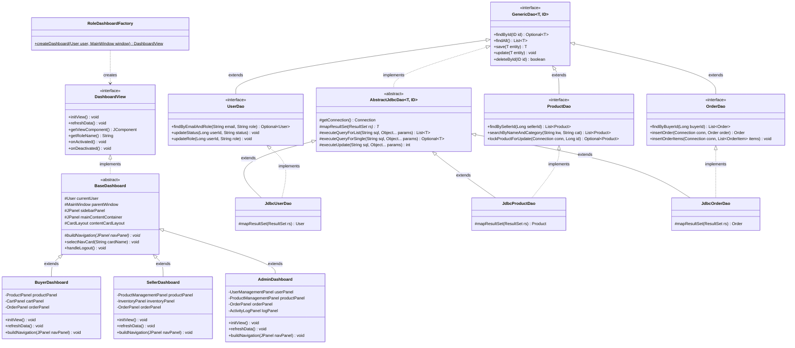

# Java Class Diagram (OOP Structure)

This document visualizes the class inheritance, interface implementation, and dependencies of the MARTplus desktop application.

---

## 1. Class Hierarchy Diagram (Mermaid)

---

## 2. Key Design Patterns Demonstrated
1. **Factory Pattern:** `RoleDashboardFactory` encapsulates dynamic subclass selection and decouples `MainWindow` from concrete dashboard types.
2. **Template Method Pattern:** `BaseDashboard.buildNavigation(JPanel navPanel)` and `AbstractJdbcDao.mapResultSet(ResultSet rs)` define algorithm skeletons while allowing subclasses to provide custom implementations.
3. **Data Access Object (DAO) Pattern:** Encapsulates all SQL execution, connection handling, and ResultSet mapping behind typed contracts (`GenericDao<T, ID>`).
4. **Model-View-Controller (MVC) Pattern:** Strict decoupling between UI view panels, controllers, domain services, and DAOs.
