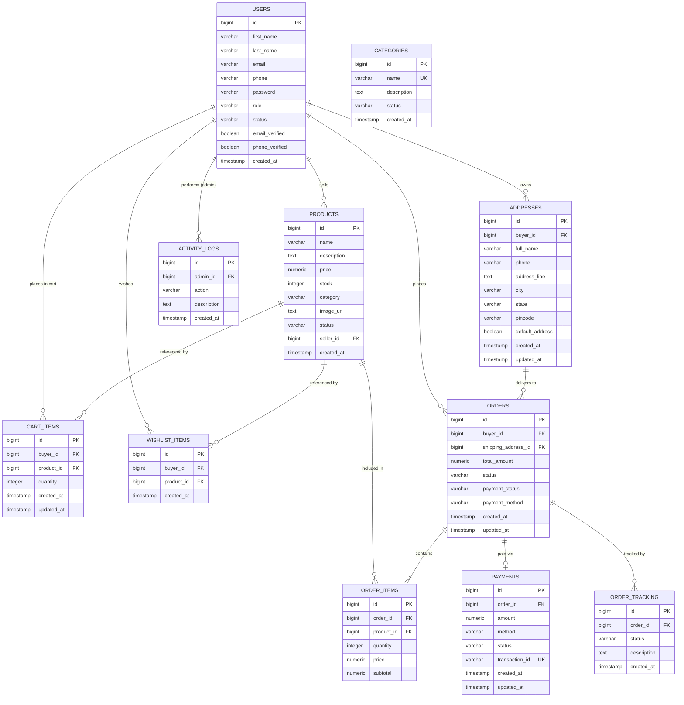

# Database Entity-Relationship (ER) Diagram

The desktop application directly reads and modifies the existing PostgreSQL schema shared with the MARTplus web application.

---

## 1. Entity-Relationship Diagram (Mermaid)

---

## 2. Table & Column Mapping Table

| PostgreSQL Table | Java Model Class | Primary Key | Foreign Keys | Key Constraints |
| :--- | :--- | :--- | :--- | :--- |
| `users` | `User` | `id` (bigint) | None | Unique: `(email, role)`, `(phone, role)` |
| `products` | `Product` | `id` (bigint) | `seller_id` $\rightarrow$ `users(id)` | `stock >= 0`, `price > 0` |
| `categories` | `Category` | `id` (bigint) | None | Unique: `name` |
| `cart_items` | `CartItem` | `id` (bigint) | `buyer_id`, `product_id` | Unique: `(buyer_id, product_id)` |
| `wishlist_items` | `WishlistItem` | `id` (bigint) | `buyer_id`, `product_id` | Unique: `(buyer_id, product_id)` |
| `addresses` | `Address` | `id` (bigint) | `buyer_id` $\rightarrow$ `users(id)` | None |
| `orders` | `Order` | `id` (bigint) | `buyer_id`, `shipping_address_id` | None |
| `order_items` | `OrderItem` | `id` (bigint) | `order_id`, `product_id` | None |
| `order_tracking` | `OrderTracking`| `id` (bigint) | `order_id` $\rightarrow$ `orders(id)` | None |
| `payments` | `Payment` | `id` (bigint) | `order_id` $\rightarrow$ `orders(id)` | Unique: `order_id`, `transaction_id` |
| `activity_logs` | `ActivityLog` | `id` (bigint) | `admin_id` $\rightarrow$ `users(id)` | None |
