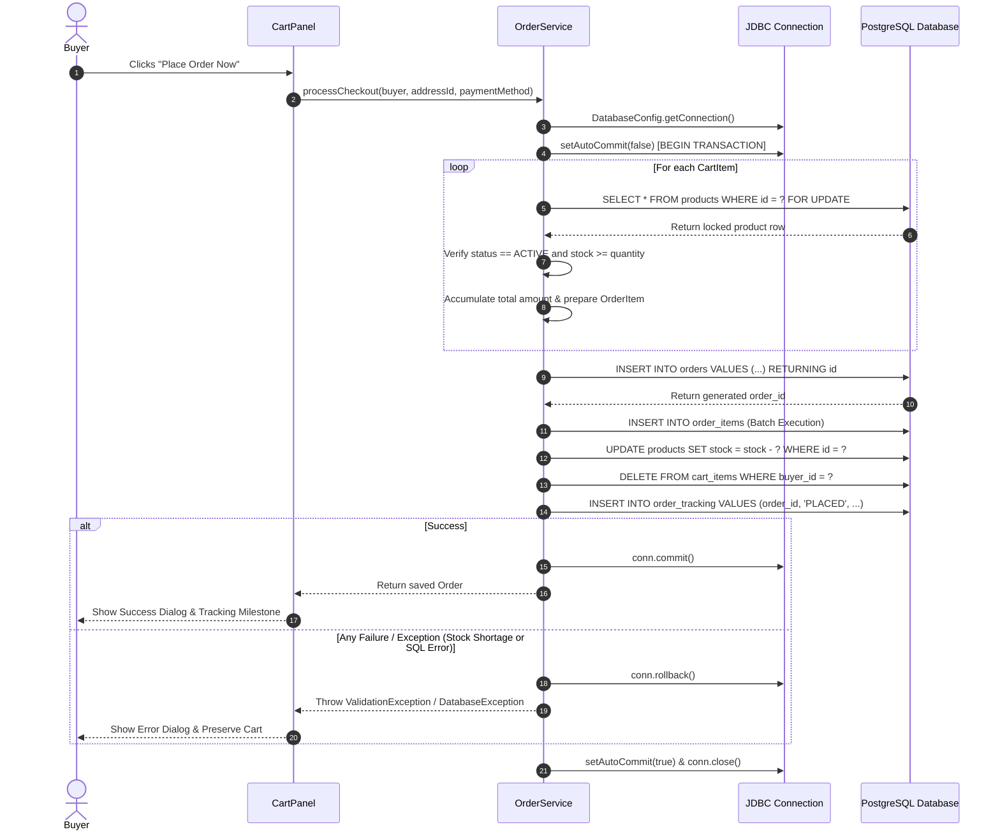

# JDBC Transaction Management (3 Marks Compliance)

This document provides a detailed breakdown of the multi-step atomic checkout transaction implemented in `OrderService.processCheckout()`.

---

## 1. Multi-Step Checkout Transaction Architecture

An e-commerce checkout is a critical distributed workflow that cannot tolerate partial state. If inventory is deducted but order insertion fails, or if an order is created without deducting inventory, financial and catalog inconsistency occurs.

The MARTplus desktop application coordinates an **atomic 12-step transaction** using raw JDBC primitives:
- `connection.setAutoCommit(false)`
- `connection.commit()`
- `connection.rollback()`

---

## 2. Step-by-Step Transaction Execution Flow

---

## 3. Transaction Safety & ACID Compliance

1. **Atomicity:** All 12 operations either complete together or none do. `conn.rollback()` ensures no dangling order rows or partial inventory deductions exist.
2. **Consistency:** Row-level checking prevents negative stock balances at both the Java application layer and the SQL constraint layer (`WHERE stock >= ?`).
3. **Isolation:** Rows are locked using `SELECT ... FOR UPDATE` within the active transaction, preventing other threads from modifying stock before this transaction commits.
4. **Durability:** Once `conn.commit()` returns, changes are persisted to the PostgreSQL write-ahead log (WAL).

---

## 4. Test Verification
- **`CheckoutTransactionTest.testCheckoutTransactionCommit`**:
  - Tests successful path: verifies `setAutoCommit(false)`, `insertOrder()`, `deductStock()`, `deleteByBuyerId()`, `insertTracking()`, and `conn.commit()`.
- **`CheckoutTransactionTest.testCheckoutTransactionRollbackOnStockShortage`**:
  - Tests failure path: simulates inventory shortfall during locked row check, verifies `conn.rollback()` is invoked and zero order items are saved.
